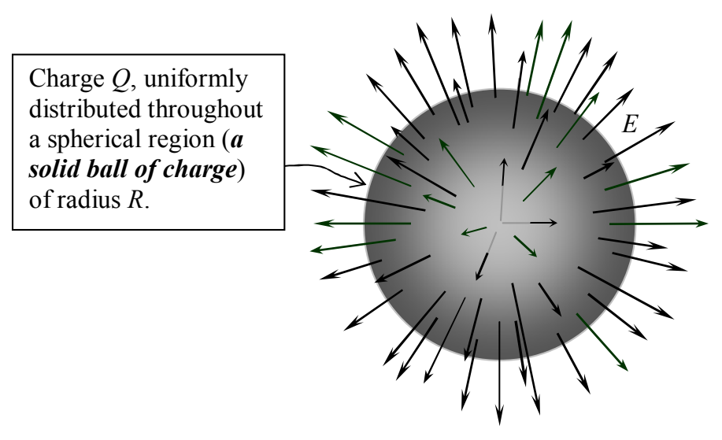

## 34 Gauss's Law Example

We finished off the last chapter by using Gauss's Law to find the electric field due to a point charge. It was an example of a charge distribution having spherical symmetry. In this chapter we provide another example involving spherical symmetry.

## Example 34-1

Find the electric field due to a uniform ball of charge of radius R and total charge Q. Express the electric field as a function of r, the distance from the center of the ball.

## Solution

Again we have a charge distribution for which a rotation through any angle about any axis passing through the center of the charge distribution results in the exact same charge distribution. Thus, the same symmetry arguments used for the case of the point charge apply here with the result that, the electric field due to the ball of charge has to be strictly radially directed, and, the electric field has one and the same value at every point on any given spherical shell centered on the center of the ball of charge. Again, we assume the electric field to be outward-directed. If it turns out to be inward-directed, we'll simply get a negative value for the magnitude of the outward-directed electric field.

