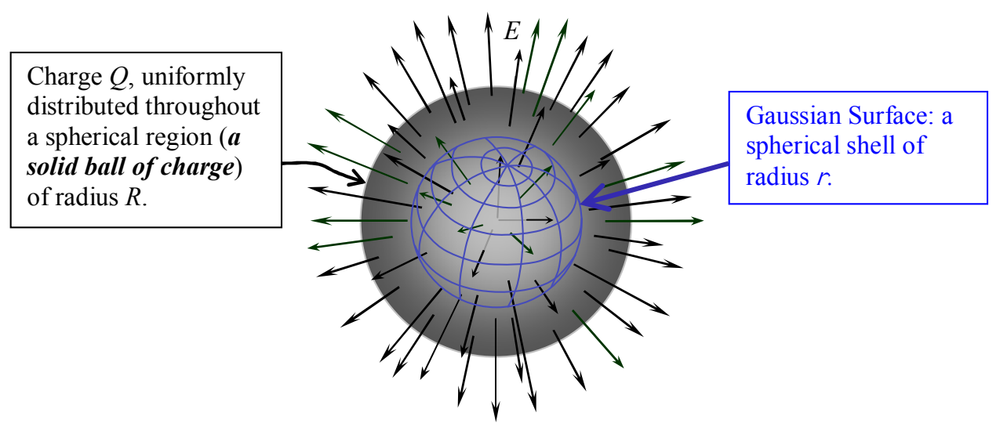

The appropriate Gaussian surface for any spherical charge distribution is a spherical shell centered on the center of the charge distribution.

Okay, let's go ahead and apply Gauss's Law.

$$\oint \vec{\mathbf{E}} \cdot \vec{\mathbf{dA}} = \frac{Q_{\text{ENCLOSED}}}{\epsilon_{\mathrm{o}}}$$

Since the electric field is radial, it is, at all points, perpendicular to the Gaussian Surface. In other words, it is parallel to the area element vector $\vec{\mathbf{dA}}$. This means that the dot product $\vec{\mathbf{E}} \cdot \vec{\mathbf{dA}}$ is equal to the product of the magnitudes, $E\,dA$. This yields:

$$\oint E\,dA = \frac{Q_{\text{ENCLOSED}}}{\epsilon_{\mathrm{o}}}$$

Again, since $E$ has the same value at all points on the Gaussian surface of radius $r$, each $dA$ in the infinite sum that the integral on the left is, is multiplied by the same value of $E$. Hence, we can factor the $E$ out of the sum (integral). This yields

$$E \oint dA = \frac{Q_{\text{ENCLOSED}}}{\epsilon_{\mathrm{o}}}$$

The integral on the left is just the infinite sum of all the infinitesimal area elements making up the Gaussian surface, our spherical shell of radius $r$. The sum of all the area elements is, of course, the area of the spherical shell. The area of a sphere is $4\pi r^2$. So,

$$E\, 4\pi r^2 = \frac{Q_{\text{ENCLOSED}}}{\epsilon_{\mathrm{o}}}$$

Now the question is, how much charge is enclosed by our Gaussian surface of radius $r$?
