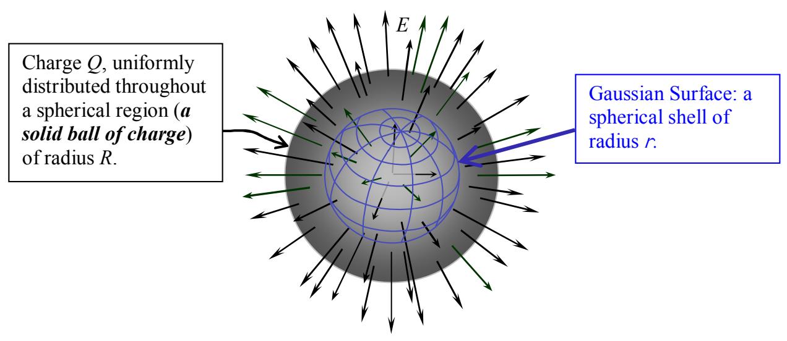

Charge $Q$, uniformly distributed throughout a spherical region (a solid ball of charge) of radius $R$.

Gaussian Surface: a spherical shell of radius $r$.

There are two ways that we can get the value of the charge enclosed. Let's try it both ways and make sure we get one and the same result.

The first way: Because the charge is uniformly distributed throughout the volume, the amount of charge enclosed is directly proportional to the volume enclosed. So, the ratio of the amount of charge enclosed to the total charge, is equal to the ratio of the volume enclosed by the Gaussian surface to the total volume of the ball of charge:

$$\frac{Q_{\text{ENCLOSED}}}{Q} = \frac{\text{Volume of Gaussian Surface}}{\text{Volume of the Entire Ball of Charge}}$$

$$\frac{Q_{\text{ENCLOSED}}}{Q} = \frac{\frac{4}{3} \pi r^3}{\frac{4}{3} \pi R^3}$$

$$Q_{\text{ENCLOSED}} = \frac{r^3}{R^3} Q$$

The second way: The other way we can look at it is to recognize that for a uniform distribution of charge, the amount of charge enclosed by the Gaussian surface is just the volume charge density, that is, the charge-per-volume $\rho$, times the volume enclosed.

$$Q_{\text{ENCLOSED}} = \rho (\text{Volume of the Gaussian Surface})$$

$$Q_{\text{ENCLOSED}} = \rho \frac{4}{3} \pi r^3$$
