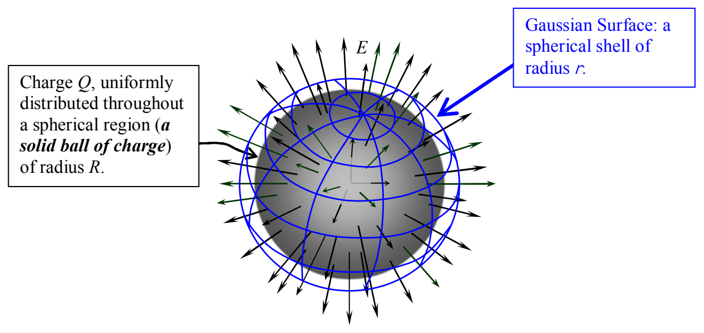

If $r \geq R$,

Charge $Q$, uniformly distributed throughout a spherical region (a solid ball of charge) of radius $R$.

Gaussian Surface: a spherical shell of radius $r$.

the analysis is identical to the preceding analysis up to and including the point where we determined that:

$$E 4\pi r^{2} = \frac{Q_{\text{ENCLOSED}}}{\epsilon_{\mathrm{o}}}$$

But as long as $r \geq R$, no matter by how much $r$ exceeds $R$, all the charge in the spherical distribution of charge is enclosed by the Gaussian surface. “All the charge” is just $Q$ the total amount of charge in the uniform ball of charge. So,

$$E 4\pi r^{2} = \frac{Q}{\epsilon_{\mathrm{o}}}$$

$$E = \frac{1}{4\pi \epsilon_{\mathrm{o}}} \frac{Q}{r^{2}}$$

The constant $\frac{1}{4\pi \epsilon_0}$ is just the Coulomb constant $k$ so we can write our result as:

$$E = \frac{k Q}{r^{2}}$$

This result looks just like Coulomb's Law for a point charge. What we've proved here is that, at points outside a spherically-symmetric charge distribution, the electric field is the same as that due to a point charge at the center of the charge distribution.
