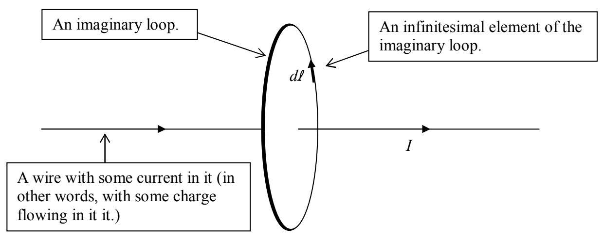

What Ampere’s Law in integral form says is that, if you sum up the magnetic-field-along-a-path-segment times the length of the path segment for all the path segments making up an imaginary closed loop, you get the current through the region enclosed by the loop, times a universal constant. The integral $\oint \vec{\mathbf{B}} \cdot \vec{\mathbf{d}}\vec{\mathbf{l}}$ on whatever closed path upon which it is carried out, is called the circulation of the magnetic field on that closed path. So, another way of stating the integral form of Ampere’s Law is to say that the circulation of the magnetic field on any closed path is directly proportional to the current through the region enclosed by the path. Here’s the picture:

In the picture, I show everything except for the magnetic field. The idea is that, for each infinitesimal segment $d\vec{l}$ of the imaginary loop, you dot the magnetic field $\vec{B}$, at the position of the segment, into $d\vec{l}$. Add up all such dot products. The total is equal to $\mu_0$ times the current $I$ through the loop.

So, what’s it good for? Ampere’s Law in integral form is of limited use to us. It can be used as a great check for a case in which one has calculated the magnetic field due to some set of current-carrying conductors some other way (e.g. using the Biot-Savart Law, to be introduced in the next chapter). Also, in cases involving a high degree of symmetry, we can use it to calculate the magnetic field due to some current.

For example, we can use Ampere’s Law to get a mathematical expression for the magnitude of the magnetic field due to an infinitely-long straight wire. I’m going to incorporate our understanding that, for a segment of wire with a current in it, the current creates a magnetic field which forms loops about the wire in accord with the right-hand rule for something curly something straight. In other words, we already know that for a long straight wire carrying current directly away from you, the magnetic field extends in loops about the wire, which, from your vantage point, are clockwise.
