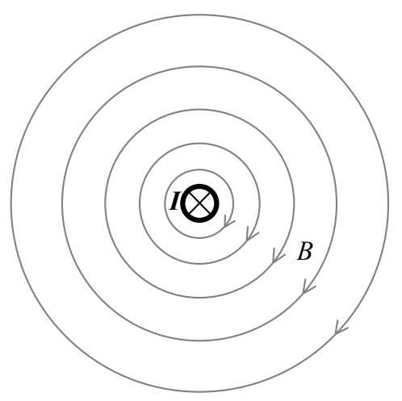
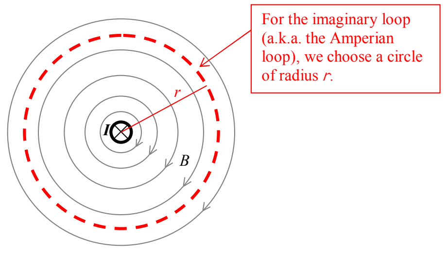

From symmetry, we can argue that the magnitude of the magnetic field is the same for a given point as it is at any other point that is the *same distance* from the wire as that given point. In implementing Ampere’s Law, it is incumbent upon us to choose an imaginary loop, called an Amperian Loop in this context, that allows us to get some useful information from Ampere’s Law. In this case, a circle whose plane is perpendicular to the straight wire and whose center lies on the straight wire is a smart choice.

At this point I want to share with you some directional information about the integral form of Ampere’s Law. Regarding the $\overrightarrow{\mathbf{d}\boldsymbol{\ell}}$ : each $\overrightarrow{\mathbf{d}\boldsymbol{\ell}}$ vector can, from a given point of view, be characterized as representing either a clockwise step along the path or a counterclockwise step along the path. And, if one is clockwise, they all have to be clockwise. If one is counterclockwise, they all have to be counterclockwise. Thus, in carrying out the integral around the closed loop, the traversal of the loop is either clockwise or counterclockwise from a specified viewpoint. Now, here’s the critical direction information: Current that passes through the loop in that direction which relates to the sense (clockwise or counterclockwise) of loop traversal in accord with the right-hand rule for something curly something straight (with the loop being the something curly and the current being the something straight) is considered positive. So, for the case at hand, if I choose a clockwise loop traversal, as viewed from the vantage point that makes things look like:
