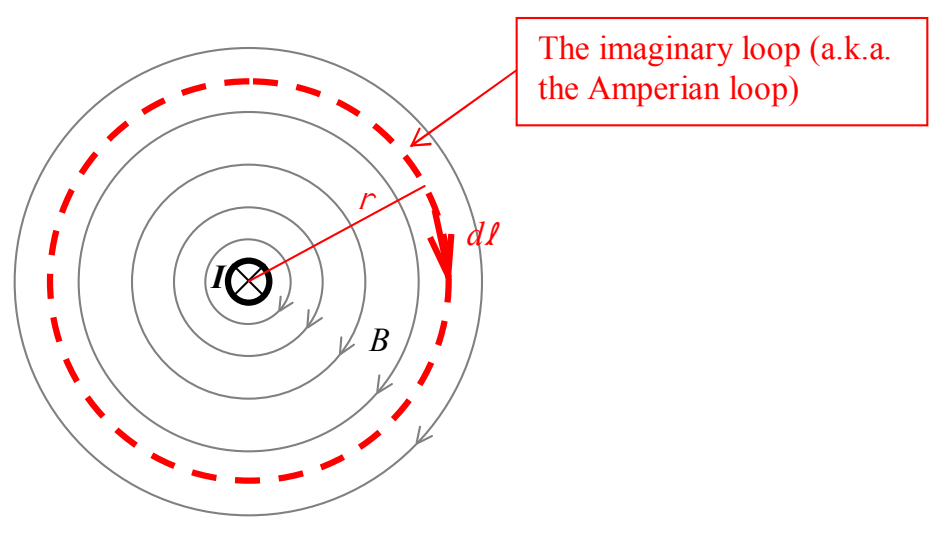

then, the current $I$ is considered positive. If you curl the fingers around the loop in the clockwise direction, your thumb points away from you. This means that current, through the loop that is directed away from you is positive. That is just the kind of current we have in the case at hand. So, when we substitute the $I$ for the case at hand into the generic equation (Ampere’s Law),

$$\oint \vec{\mathbf{B}} \cdot \vec{\mathbf{d\ell}} = \mu_{\mathrm{o}} I_{\text{THROUGH}}$$

for the current $I_{\text{THROUGH}}$ it goes in with a “+” sign.

$$\oint \vec{\mathbf{B}} \cdot \vec{\mathbf{d\ell}} = \mu_{\mathrm{o}} I$$

Now, with the loop $I$ chose, every $\vec{\mathbf{d\ell}}$ is exactly parallel to the magnetic field $\vec{\mathbf{B}}$ at the location of the $\vec{\mathbf{d\ell}}$, so, $\vec{\mathbf{B}} \cdot \vec{\mathbf{d\ell}}$ is simply $B\,d\ell$. That is, with our choice of Amperian loop, Ampere’s Law simplifies to:

$$\oint B\,d\ell = \mu_{\mathrm{o}} I$$

Furthermore, from symmetry, with our choice of Amperian loop, the magnitude of the magnetic field $B$ has one and the same value at every point on the loop. That means we can factor the magnetic field magnitude $B$ out of the integral. This yields:

$$B \oint d\ell = \mu_{\mathrm{o}} I$$

Okay, now we are on easy street. The $\oint d\ell$ is just the sum of all the $d\ell$’s making up our imaginary loop (a circle) of radius $r$. Hey, that’s just the circumference of the circle $2\pi r$. So, Ampere’s Law becomes:

$$B(2\pi r) = \mu_{\mathrm{o}} I$$
