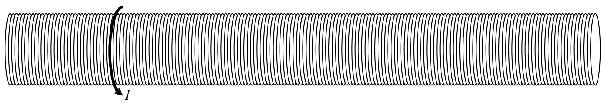

which means

$$B = \frac{\mu_{\mathrm{o}} I}{2 \pi r}$$

This is our end result. The magnitude of the magnetic field due to a long straight wire is directly proportional to the current in the wire and inversely proportional to the distance from the wire.

## A Long Straight Solenoid

A solenoid is a coil of wire in the form of a cylindrical shell. The idealized solenoid that we consider here is infinitely long but, it has a fixed finite radius $R$ and a constant finite current $I$.

It is also characterized by its number-of-turns-per-length, $n$, where each “turn” (a.k.a. winding) is one circular current loop. In fact, we further idealize our solenoid by thinking of it as an infinite set of circular current loops. An actual solenoid approaches this idealized solenoid, but, in one turn (in the view above), the end of the turn is displaced left or right from the start of the turn by an amount equal to the diameter of the wire. As a result, in an actual solenoid, we have (in the view above) some left-to-right or right-to-left (depending on which way the wire wraps around) current. We neglect this current and consider the current to just go “round and round.”

Our goal here is to find the magnetic field due to an ideal infinitely-long solenoid that has a number-of-turns-per-length $n$, has a radius $R$, and carries a current $I$.
