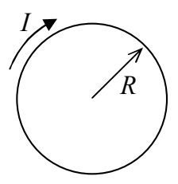
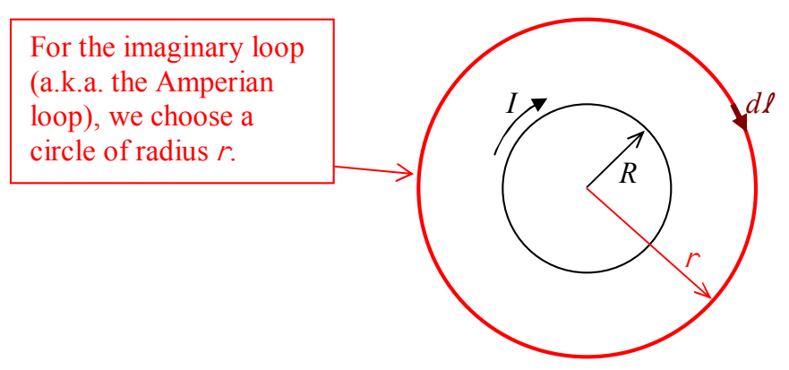

We start by looking at the solenoid in cross section. Relative to the view above, we’ll imagine looking at the solenoid from the left end. From that point of view, the cross section is a circle with clockwise current:

Let’s try an Amperian loop in the shape of a circle, whose plane is perpendicular to the axis of symmetry of the solenoid, a circle that is centered on the axis of symmetry of the solenoid.

From symmetry, we can argue that if the magnetic field has a component parallel to the depicted $\overrightarrow{\boldsymbol{d\ell}}$, then it must have the exact same component for every $\overrightarrow{\boldsymbol{d\ell}}$ on the closed path. But this would make the circulation $\oint \vec{\mathbf{B}} \cdot \overrightarrow{\boldsymbol{d\ell}}$ non-zero in contradiction to the fact that no current passes through the region enclosed by the loop. This is true for any value of $r$. So, the magnetic field can have no component tangent to the circle whose plane is perpendicular to the axis of symmetry of the solenoid, a circle that is centered on the axis of symmetry of the solenoid.

Now suppose the magnetic field has a radial component. By symmetry it would have to be everywhere directed radially outward from the axis of symmetry of the solenoid, or everywhere radially inward. In either case, we could construct an imaginary cylindrical shell whose axis of symmetry coincides with that of the solenoid. The net magnetic flux through such a Gaussian surface would be non-zero in violation of Gauss’s Law for the magnetic field. Hence the solenoid can have no radial magnetic field component.

The only kind of field that we haven’t ruled out is one that is everywhere parallel to the axis of symmetry of the solenoid. Let’s see if such a field would lead to any contradictions.
