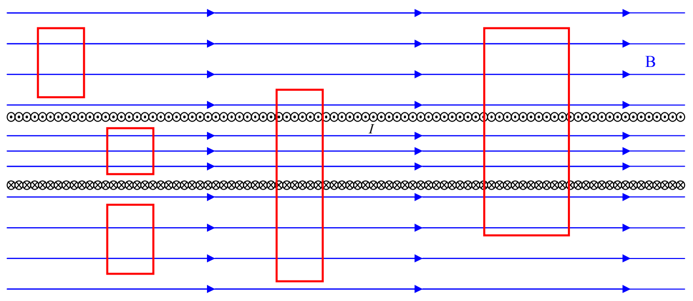

Here we view the solenoid in cross-section from the side. At the top of the coil, we see the current directed toward us, and, at the bottom, away. The possible longitudinal (parallel to the axis of symmetry of the solenoid) magnetic field is included in the diagram.

The rectangles in the diagram represent Amperian loops. The net current through any of the loops, in either direction (away from you or toward you) is zero. As such, the circulation $\oint \vec{\mathbf{B}} \cdot \vec{\mathbf{d}}\vec{\mathbf{l}}$ is zero. Since the magnetic field on the right and left of any one of the loops is perpendicular to the right and left sides of any one of the loops, it makes no contribution to the circulation there. By symmetry, the magnetic field at one position on the top of a loop is the same as it is at any other point on the top of the same loop. Hence, if we traverse any one of the loops counterclockwise (from our viewpoint) the contribution to the circulation is $-B_{\mathrm{TOP}}L$ where $L$ is the length of the top and bottom segments of whichever loop you choose to focus your attention on. The “-” comes from the fact that I have (arbitrarily) chosen to traverse the loop counterclockwise, and, in doing so, every $\vec{\mathbf{d}}\vec{\mathbf{l}}$ in the top segment is in the opposite direction to the direction of the magnetic field at the top of the loop. The contribution to the circulation by the bottom segment of the same loop is $+B_{\mathrm{BOTTOM}}L$. What we have so far is:

$$
\oint \vec{\mathbf{B}} \cdot \vec{\mathbf{d}}\vec{\mathbf{l}} = \mu_{\mathrm{o}} I_{\mathrm{THROUGH}}
$$

$$
\oint \vec{\mathbf{B}} \cdot \vec{\mathbf{d}}\vec{\mathbf{l}} = 0
$$

(where the net current through any one of the loops depicted is zero by inspection.)

$$
0 + -B_{\mathrm{TOP}} L + 0 + B_{\mathrm{BOTTOM}} L = 0
$$

(with the two zeros on the left side of the equation being from the right and left sides of the loop where the magnetic field is perpendicular to the loop.)
