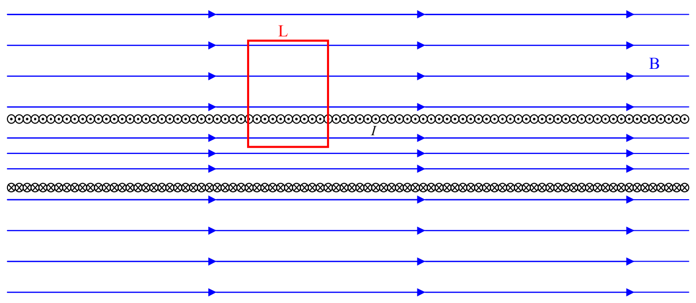

Solving for $B_{\text{BOTTOM}}$ we find that, for every loop in the diagram (and the infinite number of loops enclosing a net current of zero just like them):

$$B_{\text{BOTTOM}} = B_{\text{TOP}}$$

What this means is that the magnetic field at all points outside the solenoid has one and the same magnitude. The same can be said about all points inside the solenoid, but, the inside-the-solenoid value may be different from the outside value. In fact, let's consider a loop through which the net current is not zero:

Again, I choose to go counterclockwise around the loop (from our viewpoint). As such, by the right-hand rule for something curly something straight, current directed toward us through the loop is positive. Recalling that the number-of-turns-per-length-of-the-solenoid is $n$, we have, for the loop depicted above,

$$\oint \vec{\mathbf{B}} \cdot \vec{\mathbf{dl}} = \mu_o I_{\text{THROUGH}}$$

$$0 + -B_{\text{TOP}} L + 0 + B_{\text{BOTTOM}} L = \mu_o n L I$$

$$B_{\text{BOTTOM}} = B_{\text{TOP}} + \mu_o n I$$

The bottom of the loop is inside the solenoid and we have established that the magnitude of the magnetic field inside the solenoid has one and the same magnitude at all points inside the solenoid. I'm going to call that $B_{\text{INSIDE}}$, meaning that $B_{\text{BOTTOM}} = B_{\text{INSIDE}}$. Similarly, we have found that the magnitude of the magnetic field has one and the same (other) value at all points outside the solenoid. Let's call that $B_{\text{OUTSIDE}}$, meaning that $B_{\text{TOP}} = B_{\text{OUTSIDE}}$. Thus:

$$B_{\text{INSIDE}} = B_{\text{OUTSIDE}} + \mu_o n I$$
