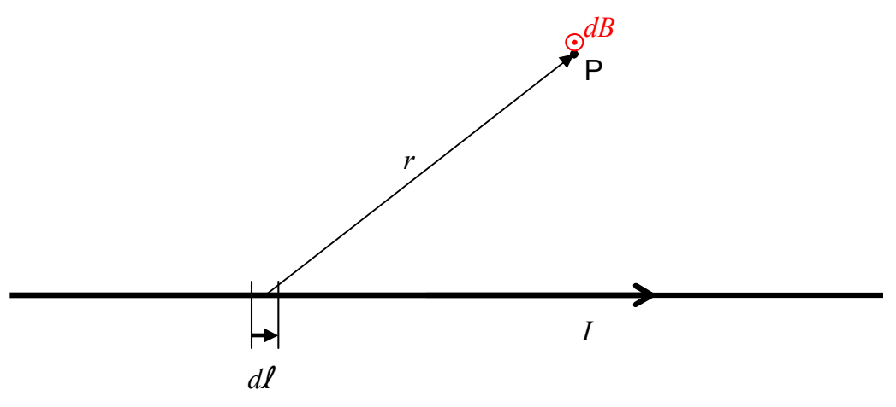

# 36 The Biot-Savart Law

The Biot-Savart Law provides us with a way to find the magnetic field at an empty point in space, let’s call it point $P$, due to current in wire. The idea behind the Biot-Savart Law is that each infinitesimal element of the current-carrying wire makes an infinitesimal contribution to the magnetic field at the empty point in space. Once you find each contribution, all you have to do is add them all up. Of course, there are an infinite number of contributions to the magnetic field at point $P$ and each one is a vector, so, we are talking about an infinite sum of vectors. This business should seem familiar to you. You did this kind of thing when you were calculating the electric field back in Chapter 30 The Electric Field Due to a Continuous Distribution of Charge on a Line. The idea is similar, but here, of course, we are talking about magnetism.

The Biot-Savart Law gives the infinitesimal contribution to the magnetic field at point $P$ due to an infinitesimal element of the current-carrying wire. The following diagram helps to illustrate just what the Biot-Savart Law tells us.

The Biot-Savart Law states that:

$$\vec{\mathbf{dB}} = \frac{\mu_{\mathrm{o}}}{4\pi}\,\frac{I\,\vec{\mathbf{d\ell}}\times\vec{\mathbf{r}}}{r^{3}}$$

(36-1)

The Biot-Savart Law represents a powerful straightforward method of calculating the magnetic field due to a current distribution.
