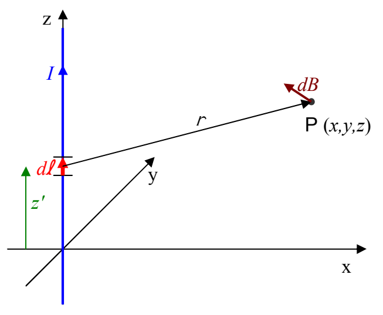

## Example 36-1

Calculate the magnetic field due to a long straight wire carrying a current $I$ along the z axis in the positive z direction. Treat the wire as extending to infinity in both directions.

## Solution

Each infinitesimal element of the current-carrying conductor makes a contribution $\vec{dB}$ to the total magnetic field at point $P$.

The $\vec{r}$ vector extends from the infinitesimal element at $(0,0,z')$ to point $P$ at $(x, y, z)$.

$$
\vec{r} = (x\hat{\mathbf{i}} + y\hat{\mathbf{j}} + z\hat{\mathbf{k}}) - z'\hat{\mathbf{k}}
$$

$$
\vec{r} = x\hat{\mathbf{i}} + y\hat{\mathbf{j}} + (z - z')\hat{\mathbf{k}}
$$

The magnitude of $\vec{r}$ is thus:

$$
r = \sqrt{x^2 + y^2 + (z - z')^2}
$$

The $\vec{d}\vec{l}$ vector points in the +z direction so it can be expressed as $d\vec{l} = dz'\hat{\mathbf{k}}$

With these expressions for $\vec{r}$, $r$, and $\vec{d}\vec{l}$ substituted into the Biot-Savart Law,

$$
\mathbf{d}\overrightarrow{\mathbf{B}} = \frac{\mu_\mathrm{o}}{4\pi}\,\frac{\mathcal{I}\,\mathbf{d}\overrightarrow{\mathbf{l}} \times \overrightarrow{\mathbf{r}}}{r^3}
$$

we obtain:
