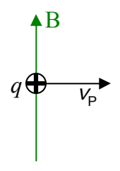
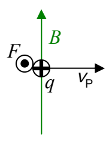

# 37 Maxwell’s Equations

In this chapter, the plan is to summarize much of what we know about electricity and magnetism in a manner similar to the way in which James Clerk Maxwell summarized what was known about electricity and magnetism near the end of the nineteenth century. Maxwell not only organized and summarized what was known, but he added to the knowledge. From his work, we have a set of equations known as Maxwell’s Equations. His work culminated in the discovery that light is electromagnetic waves.

In building up to a presentation of Maxwell’s Equations, I first want to revisit ideas we encountered in chapter 20 and I want to start that revisit by introducing an easy way of relating the direction in which light is traveling to the directions of the electric and magnetic fields that are the light.

Recall the idea that a charged particle moving in a stationary magnetic field

experiences a force given by

\[
\vec {\mathbf {F}} = q \vec {\mathbf {v}} _ {\mathrm{P}} \times \vec {\mathbf {B}}
\]

This force, by the way, is called the Lorentz Force. For the case depicted above, by the right-hand rule for the cross product of two vectors, this force would be directed out of the page.

