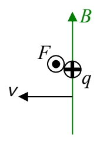
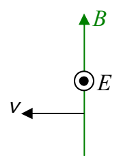

Viewing the exact same situation from the reference frame in which the charged particle is at rest we see a magnetic field moving sideways (with velocity $\vec{v} = -\vec{v}_{P}$) through the particle. Since we have changed nothing but our viewpoint, the particle is experiencing the same force.

We introduce a “middleman” by adopting the attitude that the moving magnetic field doesn’t really exert a force on the charged particle, rather it causes an electric field which does that. For the force to be accounted for by this middleman electric field, the latter must be in the direction of the force. The existence of light indicates that the electric field is caused to exist whether or not there is a charged particle for it to exert a force on.

The bottom line is that wherever you have a magnetic field vector moving sideways through space you have an electric field vector, and, the direction of the velocity of the magnetic field vector is consistent with

$$\text{direction of } \vec{\mathbf{v}} = \text{direction of } \vec{\mathbf{E}} \times \vec{\mathbf{B}}.$$

You arrive at the same result for the case of an electric field moving sideways through space. (Recall that in chapter 20, we discussed the fact that an electric field moving sideways through space causes a magnetic field.)

The purpose of this brief review of material from chapter 20 was to arrive at the result $\text{direction of } \vec{\mathbf{v}} = \text{direction of } \vec{\mathbf{E}} \times \vec{\mathbf{B}}$. This direction relation will come in handy in our discussion of two of the four equations known as Maxwell’s Equations.

One of Maxwell’s Equations is called Faraday’s Law. It brings together a couple of things we have already talked about, namely, the idea that a changing number of magnetic field lines through a loop or a coil induces a current in that loop or coil, and, the idea that a magnetic field vector that is moving sideways through a point in space causes an electric field to exist at that point in space. The former is a manifestation of the latter. For instance, suppose you have an increasing number of downward directed magnetic field lines through a horizontal loop. The idea is that for the number of magnetic field lines through the loop to be increasing, there must be magnetic field lines moving sideways through the conducting material of the loop (to get inside the perimeter of the loop). This causes an electric field in the conducting material of the
