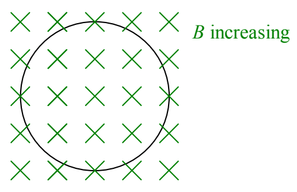

loop which in turn pushes on the charged particles of the conducting material of the loop and thus results in a current in the loop. We can discuss the production of the electric field at points in space occupied by the conducting loop even if the conducting loop is not there. If we consider an imaginary loop in its place, the magnetic field lines moving through it to the interior of the loop still produce an electric field in the loop; there are simply no charges for that field to push around the loop.

Suppose we have an increasing number of downward-directed magnetic field lines through an imaginary loop. Viewed from above the situation appears as:

The big idea here is that you can’t have an increasing number of downward-directed magnetic field lines through the region encircled by the imaginary loop without having, either, downward-directed magnetic field lines moving transversely and *inward* through the loop into the region encircled by the loop, or, upward-directed magnetic field lines moving transversely and *outward* through the loop out of the region encircled by the loop. Either way you have magnetic field lines cutting through the loop and with each magnetic field cutting through the loop there has to be an associated *electric* field with a component tangent to the loop. Our technical expression for the “number of magnetic field lines through the loop” is the magnetic flux, given, in the case of a uniform (but time-varying) magnetic field by

$$\Phi_{B} = \vec{\mathbf{B}} \cdot \vec{\mathbf{A}} \tag{37-3}$$

where $A$ is the area of the region encircled by the loop.
