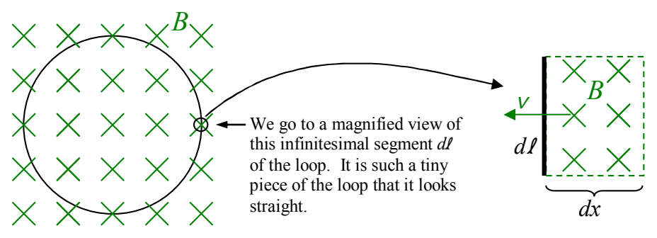

Faraday's Law, as it appears in Maxwell's Equations, is a relation between the rate of change of the magnetic flux through the loop and the electric field (produced by this changing flux) in the loop. To arrive at it, we consider an infinitesimal segment $d\ell$ of the loop and the infinitesimal contribution to the rate of change of the magnetic flux through the loop resulting from magnetic field lines moving through that segment $d\ell$ into the region encircled by the loop.

If the magnetic field depicted above is moving sideways toward the interior of the loop with a speed $v = \frac{dx}{dt}$ then all the magnetic field lines in the region of area $A = d\ell dx$, will, in time $dt$, move leftward a distance $dx$. That is, they will all move from outside the loop to inside the loop creating a change of flux, in time $dt$, of

$$d\phi_{\mathrm{B}} = BdA$$

$$d\phi_{\mathrm{B}} = Bd\ell dx$$

Now, if I divide both sides of this equation by the time $dt$ in which the change occurs, we have

$$\frac{d\phi_{\mathrm{B}}}{dt} = Bd\ell \frac{dx}{dt}$$

which I can write as

$$\dot{\phi}_{\mathrm{B}} = Bd\ell v$$

or

$$\dot{\phi}_{\mathrm{B}} = vBd\ell \tag{37-1}$$

For the case at hand, looking at the diagram, we see that $\vec{\mathbf{B}}$ and $\vec{\mathbf{v}}$ are at right angles to each other so the magnitude of $\vec{\mathbf{v}} \times \vec{\mathbf{B}}$ is just $vB$. In that case, since $\vec{\mathbf{E}} = -\vec{\mathbf{v}} \times \vec{\mathbf{B}}$ (from equation 20-1 with $-\vec{\mathbf{v}}$ in place of $\vec{\mathbf{v}}_{\mathrm{p}}$), we have $E = vB$. Replacing the product $vB$ appearing on the right side of equation 37-1 ($\dot{\phi}_{\mathrm{B}} = vBd\ell$) yields $\dot{\phi}_{\mathrm{B}} = Ed\ell$ which I copy at the top of the following page:
