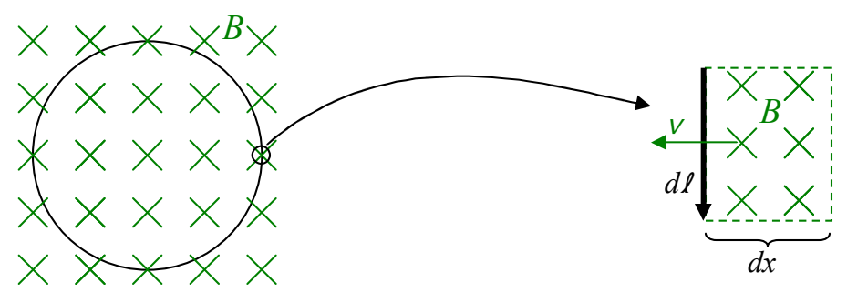

$$\dot{\phi}_B = Ed\ell$$

We can generalize this to the case where the velocity vector $\vec{v}$ is not perpendicular to the infinitesimal loop segment in which case $\vec{E}$ is not along $\vec{d\ell}$. In that case the component of $\vec{E}$ that is along $\vec{d\ell}$, times the length $d\ell$ itself, is just $\vec{E} \cdot \vec{d\ell}$ and our equation becomes

$$\dot{\phi}_B = -\vec{E} \cdot \vec{d\ell}$$

In this expression, the direction of $\vec{d\ell}$ is determined once one decides on which of the two directions in which a magnetic field line can extend through the region enclosed by the loop is defined to make a positive contribution to the flux through the loop. The direction of $\vec{d\ell}$ is then the one which relates the sense in which $\vec{d\ell}$ points around the loop, to the positive direction for magnetic field lines through the loop, by the right hand rule for something curly something straight. With this convention the minus sign is needed to make the dot product have the same sign as the sign of the ongoing change in flux. Consider for instance the case depicted in the diagram:

We are looking at a horizontal loop from above. Downward is depicted as into the page. Calling downward the positive direction for flux makes clockwise, as viewed from above, the positive sense for the $\vec{d\ell}$'s in the loop, meaning the $\vec{d\ell}$ on the right side of the loop is pointing toward the bottom of the page (as depicted). For a downward-directed magnetic field moving leftward into the loop, $\vec{E}$ must be directed toward the top of the page (from $\vec{v} = \text{direction of } \vec{E} \times \vec{B}$). Since $\vec{E}$ is in the opposite direction to that of $\vec{d\ell}$, $\vec{E} \cdot \vec{d\ell}$ must be negative. But movement of downward-directed magnetic field lines into the region encircled by the loop, what with downward being considered the positive direction for flux, means a positive rate of change of flux. The left side of $\dot{\phi}_B = -\vec{E} \cdot \vec{d\ell}$ is thus positive. With $\vec{E} \cdot \vec{d\ell}$ being negative, we need the minus sign in front of it to make the right side positive too.

Now $\dot{\phi}_B$ is the rate of change of magnetic flux through the region encircled by the loop due to the magnetic field lines that are entering that region through the one infinitesimal $\vec{d\ell}$ that we
