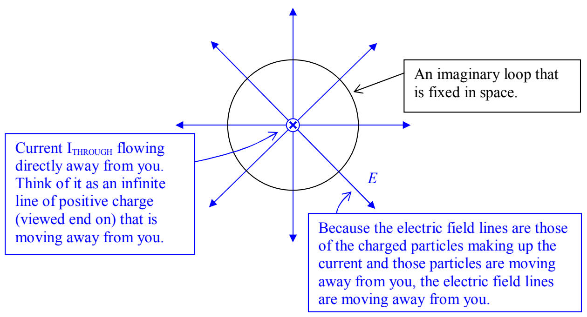

The moving charge (the current) causes electric field lines to be moving transversely through the perimeter of the loop thus causing a magnetic field in that perimeter, which, for the case depicted is clockwise as viewed from above. We typically leave out the middleman electric field when discussing this effect and say that a current through the area enclosed by a loop causes a magnetic field in that loop and call the phenomenon Ampere's Law. Careful analysis (that is not particularly difficult but I want to shorten this discussion) of the phenomenon allows us to write Ampere's Law in the form

$$
\oint \vec{\mathbf{B}} \cdot \vec{d\mathbf{l}} = \mu_{\mathrm{o}} I_{\text{THROUGH}}
$$

Note that the left side is the same as the left side of what we called Maxwell's extension to Ampere's Law integral $\oint \vec{\mathbf{B}} \cdot \vec{d\mathbf{l}} = \mu_0 \epsilon_0 \dot{\Phi}_{\mathrm{E}}$. Maxwell's extension covers the case in which there is a changing number of electric field lines through the region enclosed by the loop but no current through that region. Ampere's law covers the case in which there is a current through the region enclosed by the loop but no changing number of electric field lines through that region. If we have both a current and a changing number of electric field lines through a loop, then we have to add the two contributions to the magnetic field in the perimeter of the loop. This results in the equation

$$
\oint \vec{\mathbf{B}} \cdot \vec{d\mathbf{l}} = \mu_{\mathrm{o}} I_{\text{THROUGH}} + \mu_0 \epsilon_0 \dot{\Phi}_{\mathrm{E}}
$$

which is Ampere's Law with Maxwell's Extension. It is one of the four equations known as Maxwell's Equations.

So far in this chapter we have discussed two of the four equations known as Maxwell's Equations. The other two (both of which we have already encountered) are Gauss's Law for the electric field:

$$
\oint \vec{\mathbf{E}} \cdot \vec{\mathbf{dA}} = \frac{Q_{\text{ENCLOSED}}}{\epsilon_{\mathrm{o}}}
$$
